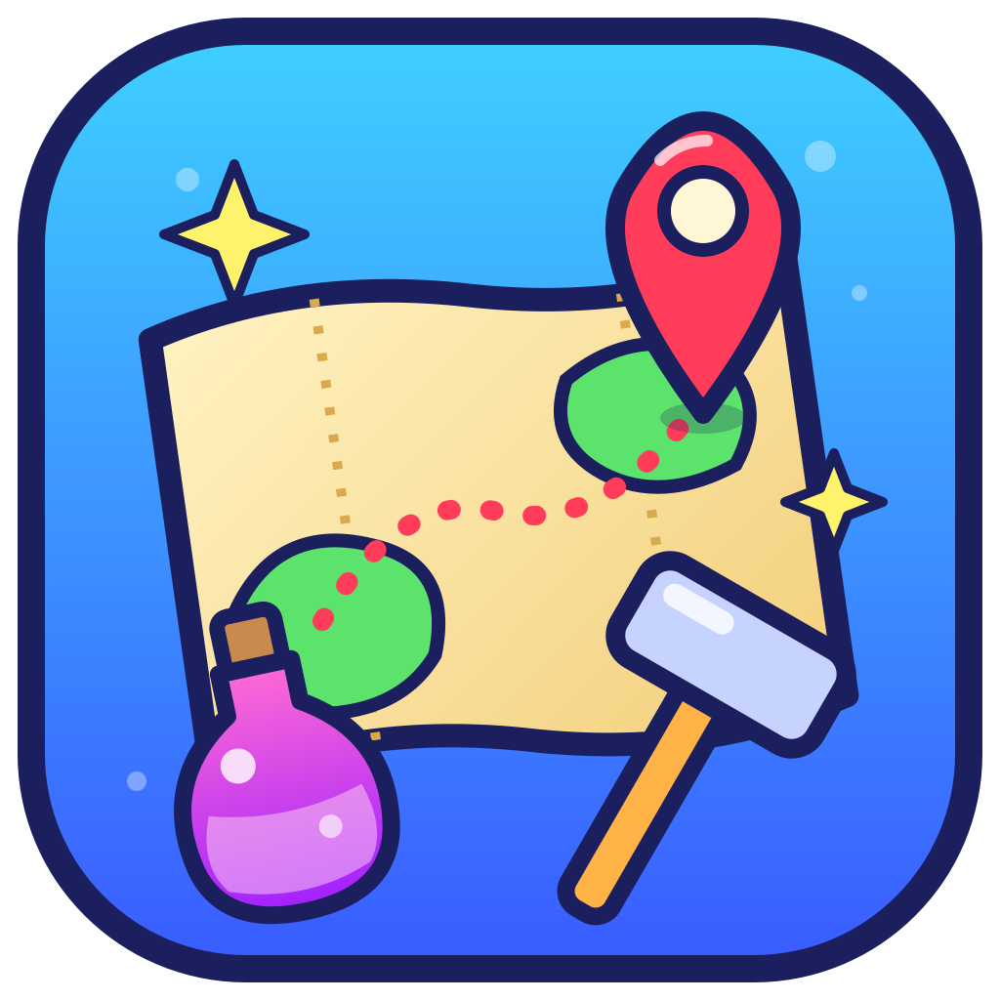
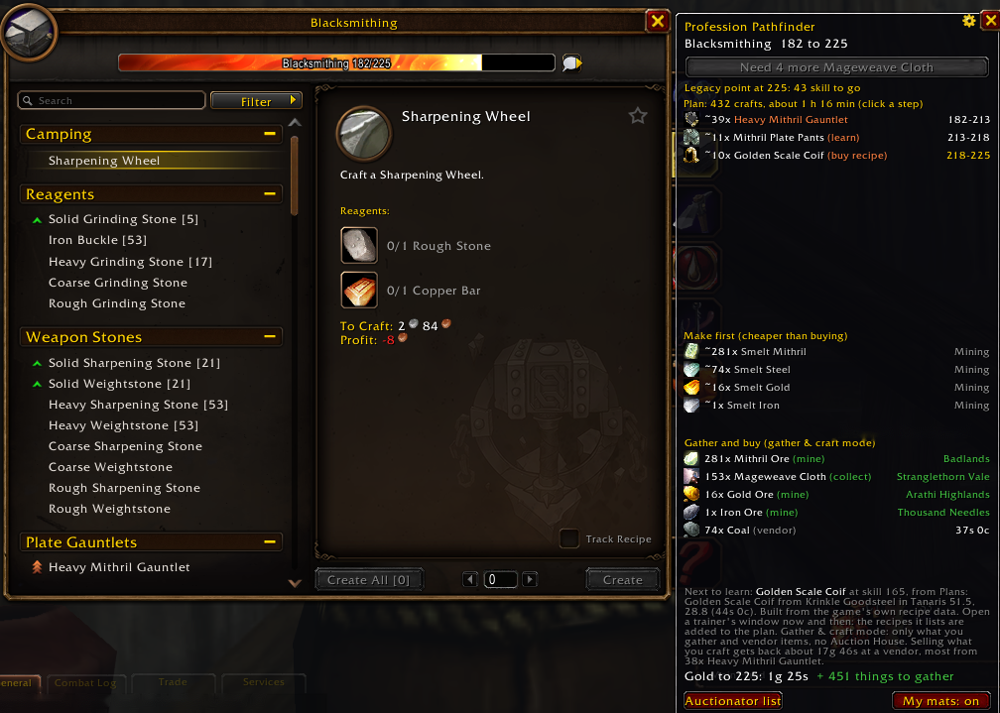

<p align="center"></p>

# Profession Pathfinder

A profession leveling helper for WoW Forever.

Open a profession and it tells you what to craft next, how many, what it'll cost, and which recipes you still need to learn and where to get them. It reads the recipe data straight from the game, so it keeps up with hotfixes.

Download it on [CurseForge](https://www.curseforge.com/wow/addons/profession-pathfinder) or from the [releases page](https://github.com/Lillefot92/ProfessionPathfinder/releases).



## What it does

- Plans the cheapest way from your current skill to your cap, or to a skill you pick. It mixes recipes you know, trainer recipes, and recipes you can buy from a vendor or the Auction House.
- Tells you where to learn each recipe: the nearest trainer for your faction, or the vendor that sells it. Click a name to put a pin on your map (TomTom works too).
- When you hit your cap it shows who teaches the next rank, including the Expert books and Artisan quests for First Aid, Cooking and Fishing.
- Shopping list with Auctionator prices, which you can send to Auctionator as a shopping list. Materials you already have are left out, and things like smelting your own bars are planned when that's cheaper.
- Counts what you get back for what you craft, selling to a vendor or on the Auction House, and picks recipes by that net cost. Pick vendor, vendor or AH, or off in the options.
- A craft button that crafts the next step for you.
- Reads every trainer window you open, and learns from your own crafts, so the estimates get better as you play.
- Counts the Working Overtime Legacy perk and shows when you're close to a Legacy point.
- With no profession window open, `/ppf` shows where to mine, pick herbs, skin and fish for your skill.
- Fishing helper: one key to cast and loot, lure reminder, zone advice, catch log, and the fish your Cooking plan still needs.
- Works in any game language.

## Commands

| Command | What it does |
|---|---|
| `/ppf` | Show or hide the window. With no profession open, it shows where to gather. |
| `/ppf options` | Settings. |
| `/ppf target <skill>` | Plan up to a skill instead of your cap (`0` = cap). |
| `/ppf bags` | Leave materials you own off the shopping list (on/off). |
| `/ppf chars` | All your characters' professions. |
| `/ppf fish` | One-key fishing on/off. `/ppf fish log` shows fishing by zone, `/ppf fish reset` starts a new session. |
| `/ppf scan` | Recipe data check, with a profession window open. Handy for bug reports. |
| `/ppf trainer` | Trainer data check, with a trainer window open. |
| `/ppf export` | For development: saves the game's recipe names, used to rebuild `Sources.lua`. |

`/pathfinder` works too.

## Good to know

- Works for both Horde and Alliance. Horde has had the most time in game so far, so if anything looks off on the Alliance side, let me know.
- Recipes that only drop or come from quests aren't part of the plan, since you can't count on getting them. They still show up in the tooltips.
- Recipes no item teaches are treated as trainer recipes and marked "(learn?)" until you've opened a trainer that lists them. Trainers only show recipes up to your current rank, so visit the trainer at each rank.
- Some trainers in the new Forever zones (Zephras Isle, Riverglades) may be missing for now.
- Skill-ups are random, so the craft counts are estimates.

## Where the data comes from

| What | Source |
|---|---|
| Recipes, materials, grey levels | The game, read from your profession window |
| Where a recipe turns yellow | Blizzard's `SkillLineAbility` table, in `Data.lua` |
| Trainer skill and price | Trainer windows: `TrainerData.lua`, plus every trainer you open |
| Prices | Auctionator, if you have it |
| Trainers, rank books and quests, recipe vendors and drops, NPC locations | [QuestieDB](https://github.com/Questie/QuestieDB)'s WoW Forever data (GPL-3.0), in `Sources.lua` |
| Gathering zone tips | Community leveling guides such as wow-professions.com |

## Bugs and ideas

Open an issue here or leave a comment on CurseForge. If something's wrong with a plan, a screenshot and the text from `/ppf scan` help a lot: open the profession window, type the command, and press Ctrl+C in the window that pops up.

## For developers

Tests run with Python and [lupa](https://pypi.org/project/lupa/) against a mocked game API:

```
pip install lupa
python tests/run_tests.py
```

- `tools/make_data.py` builds `Data.lua` from a wago.tools SkillLineAbility CSV.
- `tools/make_trainer.py` merges trainer data from SavedVariables files into `TrainerData.lua`.
- `tools/make_sources.py` builds `Sources.lua` from a [QuestieDB](https://github.com/Questie/QuestieDB) checkout and a SavedVariables file with `/ppf export` in it.

Pushing a `v*` tag builds a release with the BigWigs packager.

## License

GPL-3.0-or-later, see [LICENSE](LICENSE). `Sources.lua` is built from QuestieDB (GPL-3.0), thanks to the Questie team.

Made by Krigar Kossan.
